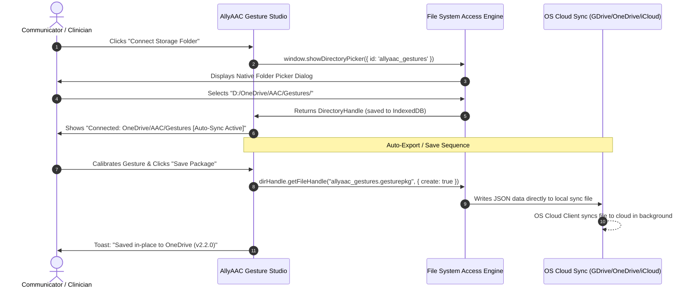
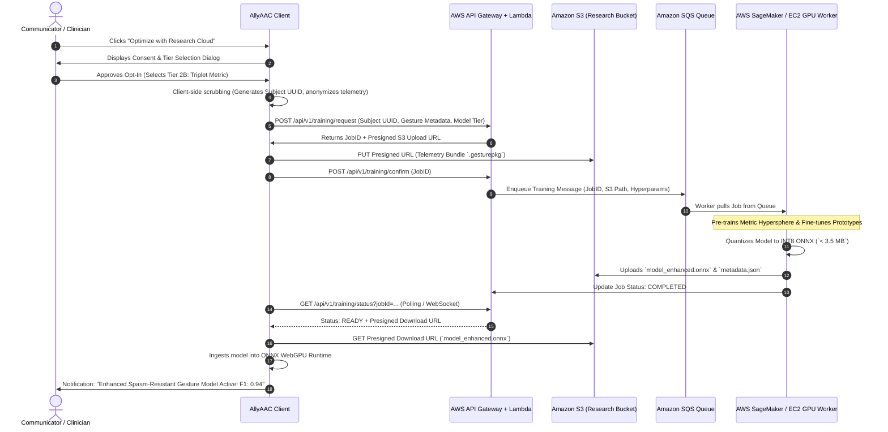

# Product Requirements Document (PRD)
# AllyAAC: Modern File System & Cloud Fine-Tuning Exchange (AWS Cloud Hub)

* **Document Version**: 1.0.0  
* **Date**: October 9, 2026  
* **Status**: Approved for Implementation / Architecture Specification  
* **Target Systems**: AllyAACUI (Canonical Multi-Modal UI), AllyAAC-PWA, AllyAAC-Windows (Desktop), AllyAAC-Android  
* **Cloud Architecture**: AWS Cloud Infrastructure (AWS S3, API Gateway, Lambda, SageMaker / EC2 GPU Fine-Tuning Workers)  
* **Related Specifications**: 
  - [Gesture Studio PRD](file:///d:/projects/aac/AllyAAC/AllyAACUI/docs/GESTURE_STUDIO_PRD.md)
  - [Video-to-IMU Sync Specification](file:///d:/projects/aac/AllyAAC/AllyAACUI/docs/VIDEO_IMU_SYNC.md)

---

## 1. Executive Summary & Vision

Communicators using AllyAAC rely on custom gestures calibrated across multimodal sensors—Movesense 9-DoF IMU telemetry and MediaPipe 3D vision landmarks. However, communicators, caregivers, and clinicians currently face two significant pain points:

1. **Storage Friction & Fragmentation:** Browser downloads (`data:text/json...` anchor links) dump timestamped `.gesturepkg` and `.json` files into unstructured default download directories, requiring manual file management and complicating seamless cross-device synchronization (e.g. syncing with Google Drive, Microsoft OneDrive, Nextcloud, or iCloud).
2. **Compute Limitations for Advanced Models:** On-device training is currently restricted to deterministic rules (Tier 0: SW-RKPIC) and symbolic sequence matchers (Tier 1: LCSS), which struggle with severe spasticity, athetoid dystonia, and tremor spasms. High-accuracy transformer architectures (Tier 2A: Masked MAE, Tier 2B: Triplet Metric Hypersphere, Tier 2C: InfoNCE CPC, and Tier 3: Multimodal Vision+IMU Cross-Attention) require substantial GPU compute to train and fine-tune.

### The Solution:
1. **Modern Native File System Integration:** Implement the W3C **File System Access API** with fallbacks to the HTML5 File API and Android Storage Access Framework. This provides persistent directory handles, direct in-place saving, and seamless interoperability with OS-mounted cloud folders (Google Drive, OneDrive, iCloud Drive, Nextcloud).
2. **Opt-In Research Fine-Tuning Pipeline (AWS Cloud Hub):** Provide a voluntary, transparent, privacy-centric consent mechanism for communicators to contribute anonymized gesture packages (`.gesturepkg`) and aligned sensor telemetry (`.json` + `.webm`) to the research team. In return, the research team leverages sponsored **AWS Cloud Credits** (utilizing Amazon S3, AWS Lambda, and SageMaker / EC2 GPU clusters with NVIDIA Ada / Tensor Core GPUs) to train personalized deep transformer models, returning optimized INT8 ONNX packages back to the user's AllyAAC installation.

```
+---------------------------------------------------------------------------------------------------------+
|                                      ALLYAAC GESTURE STORAGE & CLOUD HUB                                 |
+---------------------------------------------------------------------------------------------------------+
                                                     |
              +--------------------------------------+--------------------------------------+
              |                                                                             |
              v                                                                             v
   [MODERN FILE SYSTEM ENGINE]                                                   [RESEARCH CLOUD HUB]
   - File System Access API (Chromium)                                           - Ethical Informed Consent
   - Direct Folder Mounting:                                                     - PII Scrubbing & Salted ID
     * Google Drive                                                              - AWS S3 Secure Staging Bucket
     * Microsoft OneDrive                                                        - Asynchronous GPU Job Worker
     * Apple iCloud Drive                                                        - AWS SageMaker / EC2 PyTorch
   - In-place File Sync & Auto-Save                                              - Quantized ONNX Model Output
   - Legacy Download Fallback                                                    - Download Enhanced Gesture Pkg
              |                                                                             |
              +--------------------------------------+--------------------------------------+
                                                     |
                                                     v
                                [COMMUNICATOR & CLINICIAN WORKBENCH]
                                - One-click Export / Import
                                - Cloud Sync Status Indicator
                                - "Request Cloud Model Fine-Tuning" Button
                                - Model Status: [ Queued -> Training -> Ready ]
+---------------------------------------------------------------------------------------------------------+
```

---

## 2. Competitive & Technical Research

### 2.1 File Storage & Cloud Synchronization Paradigms

| Paradigm | API / Technology | Platform Compatibility | Strengths | Constraints |
| :--- | :--- | :--- | :--- | :--- |
| **Direct File System Access** | W3C `window.showDirectoryPicker()`, `showOpenFilePicker()` | Chromium (Chrome, Edge, Opera, Android Chrome Canary), Windows WebView2 | Direct file-handle persistence via IndexedDB; in-place overwriting; seamlessly reads/writes OS-synced Google Drive/OneDrive folders | Safari & Firefox require fallback to `<input type="file">` / anchor downloads |
| **Android Storage Access Framework (SAF)** | `ACTION_OPEN_DOCUMENT_TREE`, `DocumentsContract` | Android 5.0+ (Jetpack Android Target) | Universal cloud browsing: Google Drive, OneDrive, Nextcloud appear natively in file picker | Needs Kotlin / WebView JavaScriptInterface bridge in `AllyAAC-Android` |
| **Windows Desktop Native Win32 / .NET** | `Microsoft.Win32.SaveFileDialog`, `System.IO` | Windows WPF (`AllyAAC-Windows`) | Native OS dialogs, direct access to `%UserProfile%\OneDrive\` and Google Drive virtual drive letters (e.g. `G:\`) | Desktop specific; requires WebView2 host messaging |
| **Direct Web OAuth SDKs** | Google Picker API / MSAL.js | All Browsers | Web-native cloud file picking without local disk synchronization | Requires maintaining API client IDs, consent screens, and active internet connectivity |

* **Decision**: Adopt a **Progressive Enhancement Architecture**:
  1. Primary: **File System Access API** (`FileSystemFileHandle` / `FileSystemDirectoryHandle`) stored in browser IndexedDB. Allows users to select any folder on their machine—including cloud-synced folders (OneDrive, Google Drive, iCloud).
  2. Native Android Bridge: Expose SAF tree URIs to the WebView via `window.AndroidStorage`.
  3. Universal Fallback: Maintain standard `<input type="file">` and programmatic blob download triggers for older browsers.

### 2.2 AWS Cloud Architecture for Gesture Fine-Tuning

| Component | AWS Service | Purpose | Architecture Rationale |
| :--- | :--- | :--- | :--- |
| **API Ingestion Gateway** | **Amazon API Gateway (HTTP API v2)** | Authenticated REST endpoints for job dispatch and status polling | Low latency, native AWS IAM & API key authorization, automatic request throttling. |
| **Orchestration & Presigned URLs** | **AWS Lambda (Python 3.12 / Node.js 20)** | Generates pre-signed S3 upload/download URLs; queues training tasks | Serverless, zero idle cost against AWS credit burn rate. |
| **Staging & Model Repository** | **Amazon S3** | Encrypted bucket storage for telemetry bundles and output `.onnx` models | S3 Lifecycle policies automatically expire raw training data after 90 days; S3 Server-Side Encryption (SSE-S3/KMS). |
| **Task Queue** | **Amazon SQS (Simple Queue Service)** | Decouples web requests from GPU training instances | Dead-letter queues (DLQ), ensures reliable job dispatch without dropped sessions. |
| **Training & Fine-Tuning Cluster** | **Amazon SageMaker Training Jobs** or **Amazon EC2 Spot/On-Demand (g5.xlarge / g6.xlarge)** | Runs PyTorch fine-tuning for Tier 2/3 Transformers | Utilizes NVIDIA A10G / L4 GPUs with Tensor Cores; spots reduce AWS credit consumption by up to 70%. |
| **Event Notification** | **Amazon EventBridge + SNS / WebSocket** | Notifies client when model compilation finishes | Triggers Lambda to push status update or deliver via signed polling token. |

---

## 3. Privacy, Informed Consent & Clinical Ethics

Gesture training data contains sensitive biomechanical and kinematic information, and occasionally video synchronization snippets. Strict adherence to HIPAA/GDPR principles and IRB guidelines is essential:

```
+------------------------------------------------------------------------------------+
|                         INFORMED CONSENT & PRIVACY PIPELINE                         |
|                                                                                    |
| [1. EXPLICIT OPT-IN MODAL]                                                         |
| - Clear explanation in plain language (Flesch-Kincaid Grade 6 or AAC visual aids)  |
| - Distinct consent toggles:                                                        |
|   [*] Kinematic Telemetry Only (IMU 9-DoF acceleration + angular velocity)         |
|   [ ] Optical Keypoints (MediaPipe 3D normalized coordinates, NO raw RGB video)    |
|   [ ] Synchronized RGB Video Clip (Optional for clinical validation)               |
|                                                                                    |
| [2. CLIENT-SIDE DATA SANITIZATION]                                                 |
| - Strips all personal identifers (Name, Device ID, IP Address, Caregiver Notes)    |
| - Generates cryptographically secure Pseudonymous Subject ID (UUIDv4)              |
| - Hash-salts session timestamps to prevent trajectory correlation                  |
|                                                                                    |
| [3. SECURE TRANSMISSION & REST STORAGE]                                            |
| - TLS 1.3 in transit to Amazon S3                                                  |
| - AES-256 Server-Side Encryption (AWS KMS) at rest                                 |
| - Automated Data Retention Sunset (Raw telemetry purged after model convergence)   |
| - "Right to be Forgotten": User can revoke Subject UUID at any time                |
+------------------------------------------------------------------------------------+
```

---

## 4. System Architecture & Workflows

### 4.1 Modern File System Workflow (Local & Cloud Sync)



### 4.2 Research Fine-Tuning Exchange Workflow (AWS Hub)



---

## 5. Technical Specifications & Data Models

### 5.1 Universal Gesture Package Specification (`.gesturepkg` v2.2.0)

The package structure is extended to support cloud synchronization tags, anonymized subject UUIDs, and embedded or linked ONNX models:

```json
{
  "$schema": "https://allyaac.org/schemas/v2.2/gesturepkg.json",
  "version": "2.2.0",
  "packageId": "pkg_9f8a3c1e-4b2a-4a1d-b892-c9a87d65e431",
  "subjectUuid": "sub_anon_87e2f140-5a39-4d62-9e2c-bb1456a8d011",
  "exportedAt": "2026-10-09T20:15:00.000Z",
  "cloudSync": {
    "providerHint": "onedrive",
    "lastSyncedAt": "2026-10-09T20:15:02.000Z",
    "syncRevision": 4
  },
  "researchOptIn": {
    "consented": true,
    "consentTimestamp": "2026-10-09T20:12:00.000Z",
    "consentVersion": "IRB-2026-AAC-04",
    "telemetryIncluded": ["imu_6dof", "mediapipe_landmarks_3d"],
    "rgbVideoIncluded": false
  },
  "thresholds": {
    "dynamicThreshold": 18,
    "shockThreshold": 2200,
    "dwellRequired": 240,
    "confidenceCutoff": 0.82
  },
  "templates": [
    {
      "id": "tmpl_nod_yes",
      "name": "Head Nod (Yes)",
      "action": "speak:Yes",
      "tier": "Tier 1: LCSS",
      "featureVector": [0.12, -0.45, 0.88, 12.3, -4.1, 8.9],
      "imuSamplesCount": 48
    }
  ],
  "enhancedCloudModel": {
    "activeTier": "Tier 2B: Triplet Metric",
    "modelFormat": "onnx_int8",
    "modelHash": "sha256_e3b0c44298fc1c149afbf4c8996fb92427ae41e4649b934ca495991b7852b855",
    "f1Score": 0.942,
    "falsePositiveResistance": 0.985,
    "onnxModelUrl": "local:models/model_enhanced.onnx"
  }
}
```

### 5.2 Research API Contracts (AWS Gateway)

#### Request Training Job
* **Endpoint**: `POST /api/v1/training/request`
* **Request Body**:
```json
{
  "subjectUuid": "sub_anon_87e2f140-5a39-4d62-9e2c-bb1456a8d011",
  "modelTierRequested": "tier_2b_triplet",
  "clientVersion": "AllyAAC-3.1.0",
  "sampleCount": 35,
  "negativeNoiseSpasmCount": 12,
  "hardwareTarget": "webgpu_wasm"
}
```
* **Response (200 OK)**:
```json
{
  "jobId": "job_aws_20261009_9831",
  "uploadUrl": "https://allyaac-research-staging.s3.amazonaws.com/uploads/job_aws_20261009_9831.bundle?AWSAccessKeyId=...",
  "expiresInSeconds": 3600
}
```

#### Poll Status / Model Retrieval
* **Endpoint**: `GET /api/v1/training/status?jobId=job_aws_20261009_9831`
* **Response (Training)**:
```json
{
  "jobId": "job_aws_20261009_9831",
  "status": "TRAINING",
  "progressPct": 65,
  "estimatedTimeRemainingSeconds": 140
}
```
* **Response (Completed)**:
```json
{
  "jobId": "job_aws_20261009_9831",
  "status": "COMPLETED",
  "downloadUrl": "https://allyaac-research-staging.s3.amazonaws.com/models/job_aws_20261009_9831_int8.onnx?AWSAccessKeyId=...",
  "metrics": {
    "f1Score": 0.942,
    "meanInferenceLatencyMs": 18.4,
    "modelSizeBytes": 3412096
  }
}
```

---

## 6. Phased Implementation Roadmap

```
+----------------------------------------------------------------------------------------------------+
|                                    PHASED IMPLEMENTATION ROADMAP                                   |
|                                                                                                    |
|  [PHASE 1: MODERN FILE SYSTEM]       [PHASE 2: OPT-IN UI & SANITIZER] [PHASE 3: AWS CLOUD PIPELINE]|
|  - File System Access API            - Research Consent Modal         - API Gateway & Lambda Handlers|
|  - IndexedDB Handle Store            - Anonymization Sanitizer        - S3 Staging & Lifecycle      |
|  - In-Place Auto-Save                - Package Telemetry Bundler      - SQS Queue & GPU Worker      |
|  - Universal Download Fallback       - IRB Opt-In Verification        - INT8 Quantization Script    |
|                                                                                                    |
|  [PHASE 4: ONNX INGESTION & CLOSED-LOOP BENCHMARKING]                                              |
|  - Automatic Model Ingestion into Gesture Engine (WebGPU/WASM)                                     |
|  - Side-by-Side Accuracy HUD (Base vs Enhanced Cloud Model)                                        |
|  - One-Click Model Rollback & Offline Cache                                                        |
+----------------------------------------------------------------------------------------------------+
```

### Phase 1: Modern File System Access & Universal Cloud Sync (Weeks 1–2)
* Implement `src/js/storage/file_system_manager.js` in AllyAACUI.
* Support `window.showDirectoryPicker()` to attach user-selected local or cloud-synced directories (Google Drive, OneDrive, iCloud Drive).
* Persist directory handles in IndexedDB so the folder remains connected across sessions.
* Provide in-place overwriting (`saveGesturePackage()`) with visual file-sync indicators in the Gesture Studio toolbar.
* Implement automatic fallback to standard file download and `<input type="file">` for non-Chromium browsers.

### Phase 2: Client-Side Research Opt-In & Anonymization Engine (Weeks 3–4)
* Build the accessible **Research Contribution & Consent Modal** within Gesture Studio.
* Implement client-side PII scrubbing:
  - Generate non-reversible cryptographic `subjectUuid`.
  - Strip device identifiers, local paths, and user text labels.
  - Option to include/exclude optical video clips while retaining landmark coordinate arrays.
* Implement local packaging of training bundles (`.gesturepkg` + aligned sensor telemetry JSON).

### Phase 3: AWS Cloud Fine-Tuning Backend (Weeks 5–7)
* Deploy AWS Cloud Infrastructure utilizing research grant credits:
  - **Amazon S3**: Encrypted staging bucket with 90-day retention lifecycles.
  - **AWS API Gateway + Lambda**: Presigned upload/download URL generation, job tracking, and authentication.
  - **Amazon SQS**: Training job dispatch queue.
  - **AWS EC2 / SageMaker GPU Worker**: PyTorch training container running self-supervised pre-training (Masked MAE, Triplet Loss, InfoNCE) and INT8 quantization via ONNX Runtime.

### Phase 4: Closed-Loop Model Ingestion & Verification (Weeks 8–9)
* Enable AllyAAC to automatically fetch completed `.onnx` models from the cloud.
* Load the trained INT8 model into `ort-web` (ONNX Runtime Web with WebGPU acceleration).
* Provide a live comparison HUD displaying inference accuracy before vs. after fine-tuning.
* Provide one-click rollback if the user prefers previous templates or wants to run 100% offline.

---

## 7. User Experience & UI Specifications

### 7.1 Gesture Studio Header Toolbar Updates

```
+----------------------------------------------------------------------------------------------------+
| [AllyAAC Gesture Studio]   [Folder: D:/OneDrive/AAC/Gestures (Synced)] [Cloud Model: Tier 2B (94%)]|
|                                                                                                    |
| [Pair Movesense] [Live Preview]  |  [Connect Folder] [Save File] [Opt-In: Research Fine-Tuning]   |
+----------------------------------------------------------------------------------------------------+
```

1. **Storage Status Indicator**:
   * 🟢 **Connected:** Displays directory name and cloud provider hint (e.g. `OneDrive - Gestures (Auto-Saved)`).
   * 🟡 **Browser Downloads:** Displayed when running on legacy browsers without native directory access.
2. **"Research Fine-Tuning" Button**:
   * Styled with research badge (`🔬 Research AI Boost`).
   * Clicking launches the multi-step opt-in wizard.

### 7.2 Research Opt-In & Consent Modal

```
+------------------------------------------------------------------------------------+
| 🔬 Accelerate Your Gesture Accuracy with Research Cloud AI                         |
+------------------------------------------------------------------------------------+
| Our research team has high-performance GPU cloud servers (powered by AWS research   |
| credits) to train advanced deep-learning models tailored to your exact motor       |
| movement patterns.                                                                 |
|                                                                                    |
| [ ] I consent to share my anonymized sensor movements for model training           |
|                                                                                    |
| Data to Share:                                                                     |
| [x] 6-DoF Motion Sensor Data (Inertial movements only)                             |
| [x] Hand / Body Keypoint Angles (Mathematical coordinates only - NO photos/video)  |
| [ ] Camera Video Clips (Optional: helps researchers spot false activations)        |
|                                                                                    |
| Privacy Guarantee:                                                                 |
| • No names, emails, or personal identifiers are ever attached.                     |
| • Data is used strictly for AAC gesture optimization.                              |
| • You can delete your cloud-trained model or revert at any time.                   |
|                                                                                    |
| [ Cancel ]                                         [ Agree & Request Cloud AI Model ] |
+------------------------------------------------------------------------------------+
```

---

## 8. Success Metrics & Validation Criteria

| Metric | Target | Measurement Method |
| :--- | :--- | :--- |
| **File Sync Latency** | $< 50\text{ ms}$ | Time to write updated gesture package to local disk via `FileSystemFileHandle` |
| **Cross-Platform Compatibility** | $100\%$ | Works seamlessly on Windows Desktop (WPF/WebView2), Chrome/Edge PWA, and Android |
| **Anonymization Compliance** | $100\%$ zero PII | Automated validation script verifying absence of names, IP addresses, or device IDs |
| **Model Fine-Tuning Turnaround** | $< 10\text{ minutes}$ | End-to-end time from upload to ready-to-download enhanced INT8 ONNX model |
| **Gesture Accuracy Improvement** | $\ge +25\%$ F1 gain | Benchmarking Triplet Loss model vs. baseline LCSS on communicators with spasticity |
| **Model Footprint** | $< 4.0\text{ MB}$ | Quantized INT8 ONNX file size ensuring fast download and low WebGPU memory usage |
